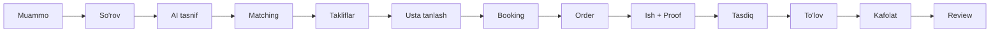
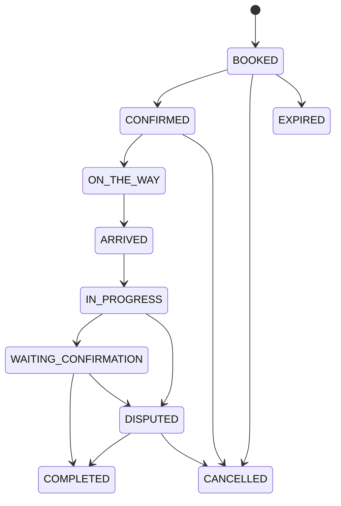
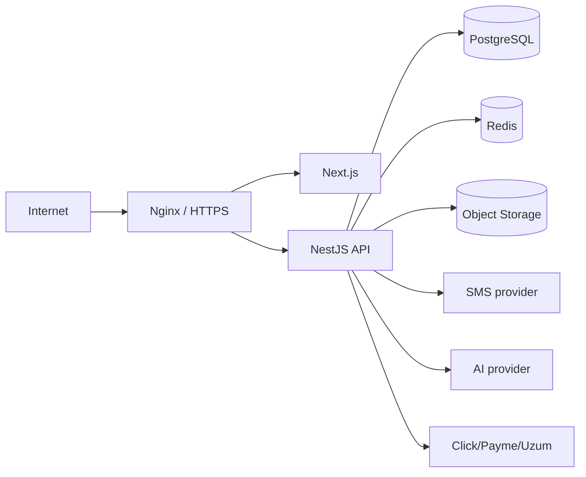
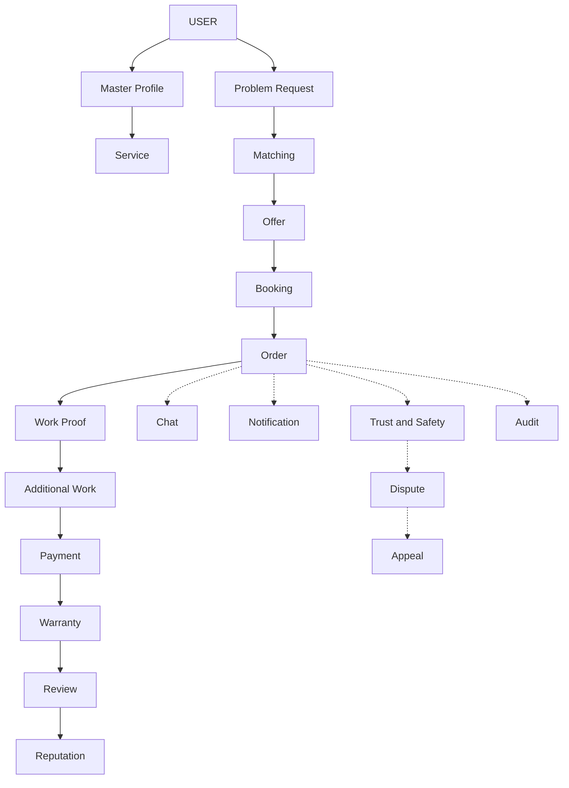

# GetMaster — To'liq Texnik Topshiriq v2.0

*Mukammallashtirilgan versiya — v1.0 asosida, barcha bo'shliqlar aniq qiymatlar bilan to'ldirilgan*

2026-09-22

## 1. Kirish, maqsad va to'liq oqim

GetMaster — mijozning uy/kundalik xizmat muammosini AI yordamida tasniflab, mos ustalar bilan bog'laydigan va butun buyurtma umrini (booking'dan to'lov va kafolatgacha) boshqaradigan marketplace.



Parallel quyi tizimlar har bir bosqichda ishlaydi: Chat, Notification, Trust & Safety, Dispute/Appeal, Audit. Ushbu v2.0 hujjat v1.0 TZ'ning barcha talablarini saqlagan holda, aniq raqamlar, kontraktlar va formulalar bilan to'ldiradi — maqsad: ishlab chiquvchi jamoa hech qanday talqin qilish zaruratisiz to'g'ridan-to'g'ri kodlay olishi.

## 2. Domen zonalari, rollar va ruxsatlar matritsasi

**Zonalar:** `/` (rol tanlash) · `/mijozlar/*` · `/ustalar/*` · `/admin/*` (himoyalangan). Har bir zona faqat o'z rolining route'larini render qiladi; noto'g'ri rol bilan kirishda 403 + role tanlash sahifasiga redirect.

**Route map** (v1.0'dan o'zgarishsiz): Mijoz — `/register, /login, /verify, /profil, /sorov-yaratish, /sorovlar, /sorovlar/[id], /takliflar, /buyurtmalar, /buyurtmalar/[id], /chat, /tolovlar, /kafolat, /shikoyatlar`. Usta — `/register, /login, /verify, /profil, /xizmatlar, /portfolio, /jadval, /verification, /sorovlar, /sorovlar/[id], /takliflar, /buyurtmalar, /buyurtmalar/[id], /chat, /tolovlar, /statistika`. Admin — `/users, /masters, /requests, /orders, /offers, /payments, /disputes, /violations, /appeals, /services, /reviews, /legal, /audit, /notifications, /settings`.

**Ruxsatlar matritsasi** (asosiy amallar; — = taqiqlangan, R = faqat o'ziniki, R-all = barcha yozuvlar):

| Amal | CUSTOMER | MASTER | ADMIN |
| --- | --- | --- | --- |
| So'rov yaratish/tahrirlash | R | — | R-all |
| Offer yuborish | — | R | — |
| Offer qabul qilish | R (o'z so'rovi) | — | — |
| Booking/Order ko'rish | R | R | R-all |
| Order status o'zgartirish | faqat CONFIRM/DISPUTE | faqat ON\_THE\_WAY→COMPLETED oralig'i | har qanday (audit bilan) |
| Work proof yuklash | — | R | — |
| Additional work so'rash | — | R | — |
| Additional work tasdiqlash | R (o'z orderi) | — | — |
| To'lov boshlash | R | — | — |
| Refund berish | — | — | R-all |
| Review yozish | R (completed order) | — | moderation (flag/hide) |
| Master verification ko'rib chiqish | — | — | R-all |

| Case (complaint/dispute) ochish | R | R | R-all |
| Case hal qilish/jazo qo'llash | — | — | R-all |
| Policy versiyalarini yaratish | — | — | R-all |
| Audit log ko'rish | — | — | R-all |

Backend darajasida bu jadval `RolesGuard` + har bir service metodida **object-level tekshiruv** (masalan `order.customerId === currentUser.sub`) orqali ikki qatlamda amalga oshiriladi — faqat rol tekshiruvi yetarli emas.

## 3. Auth, sessiya va xavfsizlik — aniq parametrlar

| Parametr | Qiymat |
| --- | --- |
| OTP kod uzunligi | 6 raqam |
| OTP amal qilish muddati | 5 daqiqa |
| OTP qayta yuborish (resend) kutish vaqti | 60 soniya |
| OTP so'rovlar limiti | 5 ta / telefon / 1 soat oynasi |
| OTP tekshirish urinishlari | 5 marta, undan keyin kod bloklanadi |
| Access JWT TTL | 900 soniya (15 daqiqa) |
| Refresh token TTL | 30 kun |
| Max faol qurilmalar soni | 2 ta (default), `MAX_ACTIVE_DEVICES` orqali sozlanadi |
| Parol talablari | kamida 8 belgi, bcrypt cost-factor 12 |
| Refresh cookie | `HttpOnly; Secure; SameSite=Lax; Path=/api/v1/auth` |
| Login rate-limit | 5 urinish / 15 daqiqa / (IP + telefon) juftligi |
| Registratsiya rate-limit | 3 ta / soat / IP |
| Akkaunt vaqtincha bloklash | 10 muvaffaqiyatsiz login / 1 soat → 15 daqiqa lock |
| Refresh-token reuse detection | eskirgan/qayta ishlatilgan refresh token aniqlansa — shu `familyId`ga tegishli barcha tokenlar zudlik bilan bekor qilinadi va foydalanuvchiga xavfsizlik ogohlantirishi yuboriladi |

**Registratsiya oqimi:** `register` → status `PENDING` → OTP (`purpose=REGISTER`) yuboriladi → `verify-registration` → talab qilingan policy versiyalari (Terms, Privacy, Platform Rules) qabul qilingan bo'lsa → status `ACTIVE`.

**Login oqimi:** `login` (telefon+parol) → agar shubhali qurilma/IP bo'lsa OTP (`purpose=LOGIN`) talab qilinadi → muvaffaqiyatli bo'lsa access JWT (response body) + refresh token (HttpOnly cookie) qaytariladi, `DeviceSession` yaratiladi/yangilanadi.

**Logout:** joriy qurilma — faqat shu `RefreshToken` va `DeviceSession` bekor qilinadi; barcha qurilmalar — foydalanuvchining barcha faol session/token'lari bekor qilinadi va audit yozuvi yaratiladi.

## 4. Ma'lumotlar bazasi arxitekturasi va ERD

Asosiy agregatlar orasidagi bog'lanish:

```mermaid
erDiagram
  User ||--o| MasterProfile : "1:1 (MASTER role)"
  User ||--o{ ProblemRequest : yaratadi
  ProblemRequest ||--o{ Offer : oladi
  Offer ||--o| Booking : "accept => 1"
  Booking ||--|| Order : yaratadi
  Order ||--o{ OrderStatusHistory : logAudit
  Order ||--o{ WorkProof : proof
  Order ||--o{ Payment : to'lov
  Order ||--o| Warranty : kafolat
  Order ||--o| Review : baho
  Order ||--o{ Case : complaint_or_dispute
  MasterProfile ||--o{ MasterService : xizmatlar
  MasterProfile ||--o{ MasterVerification : hujjatlar
```

**Domenlar bo'yicha model guruhlari** (to'liq maydonlar — loyihaning `prisma/schema.prisma` fayli, 44 model, kanonik manba hisoblanadi):

| Domen | Modellar |
| --- | --- |
| Identity | User, UserRole, RefreshToken, OtpCode, DeviceSession, PolicyVersion, PolicyAcceptance |
| Katalog/Usta | ServiceCategory, Service, MasterProfile, MasterService, MasterPortfolio, MasterAvailability, MasterVerification |
| So'rov/Matching | ProblemRequest, ProblemAttachment, AIClassification, MatchingRun, MatchingResult, Offer, Booking |
| Order | Order, OrderStatusHistory, WorkProof, AdditionalWorkRequest |
| Aloqa | Conversation, ConversationParticipant, Message |
| Moliya | Payment, Refund, Warranty, WarrantyClaim |
| Trust & Safety | Review, Case, Evidence, UserAction, Appeal, Compensation |
| Operatsiyalar | Notification, AuditLog, IdempotencyKey, OutboxEvent |

**v1.0 TZ'dan qasddan chetlashishlar** (loyihada allaqachon shunday qaror qilingan, rasmiylashtirilmoqda):

- TZ'dagi alohida `Violation`/`Penalty` o'rniga **`Case`** (COMPLAINT yoki DISPUTE turi bilan) + **`UserAction`** (WARNING/FINE/RESTRICTION/SUSPENSION/BAN) ishlatiladi — kontseptual ekvivalent, lekin kamroq jadval bilan.
- `MessageAttachment` alohida jadval emas, `Message.attachments` (Json) maydonida saqlanadi.
- Har bir `Decimal` moliyaviy maydon `@db.Decimal(14,2)` aniqligida (UZS uchun yetarli).

**Muhim cheklov:** `RefreshToken`da `@@unique([userId, deviceId])` qasddan olib tashlangan — rotation paytida eski (revoked) va yangi token bir vaqtda saqlanishi kerak (reuse detection uchun).

## 5. AI Classification — integratsiya kontrakti

AI — yakuniy hakam emas, faqat tavsiya beradi. So'rov yuborilgach BullMQ `ai-classification` navbatiga vazifa qo'yiladi (async, sinxron API javobini bloklamaydi).

**So'rov (worker → AI provider):**

```json
{
  "requestId": "uuid",
  "title": "string",
  "description": "string",
  "attachmentUrls": ["signed-url"],
  "locale": "uz"
}
```

**Javob (AI provider → worker):**

```json
{
  "categoryId": "uuid|null",
  "serviceId": "uuid|null",
  "confidence": 0.0,
  "possibleQuestions": ["string"],
  "alternatives": [{"serviceId": "uuid", "confidence": 0.0}]
}
```

**Qoidalar:**

| Holat | Amal |
| --- | --- |
| `confidence >= 0.75` | Kategoriya/xizmat avtomatik biriktiriladi, mijozga "AI aniqladi" belgisi bilan ko'rsatiladi |
| `0.4 <= confidence < 0.75` | Tavsiya sifatida ko'rsatiladi, mijoz tasdiqlashi yoki o'zgartirishi kerak |
| `confidence < 0.4` yoki AI javob bermadi | Mijozdan qo'lda kategoriya tanlash so'raladi (`possibleQuestions` fallback ro'yxati bilan) |
| AI timeout (>10s) yoki xato | 2 marta qayta urinish (exponential backoff: 2s, 8s), muvaffaqiyatsiz bo'lsa — qo'lda tanlash rejimiga o'tadi, so'rov bloklanmaydi |

Har bir AI javobi `AIClassification` jadvaliga yoziladi (`isAccepted`, `correctedAt` orqali mijoz/tizim tuzatishi kuzatiladi — kelajakda model sifatini o'lchash uchun).

## 6. Matching Engine — ball hisoblash formulasi

**Hard filters** (bittasi o'tmasa usta nomzodlikdan chiqadi): `MasterService.isActive=true` va `serviceId` mos ⑧ masofa ≤ `MasterProfile.workRadiusKm` ⑧ `MasterAvailability` bo'yicha vaqt oynasida band emas ⑧ `MasterProfile.status=ACTIVE` va `isPaused=false` ⑧ `verification=VERIFIED`.

Hard filterdan o'tgan nomzodlar uchun ball:

```latex
Score = w1*R + w2*(1 - d/dmax) + w3*A + w4*(rating/5) + w5*C + w6*P - w7*K
```

| Belgi | Ma'no | Og'irlik |
| --- | --- | --- |
| R | service relevance (0–1), AI confidence yoki exact-match | w1 = 0.25 |
| d/dmax | masofa nisbati: distanceKm / workRadiusKm | w2 = 0.20 |
| A | availability (0 yoki 1), joriy vaqt oynasida bo'shmi | w3 = 0.10 |
| rating/5 | ratingAvg / 5 | w4 = 0.20 |
| C | completionRate (0–1) | w5 = 0.15 |
| P | responseRate (0–1) | w6 = 0.10 |
| K | recent cancellation penalty (0–1), oxirgi 30 kunda bekor qilishlar nisbati | w7 = 0.15 |

Og'irliklar yig'indisi w1..w6 = 1.0; w7 jarima sifatida qo'shimcha ayiriladi. Algoritm versiyasi (`MatchingRun.algorithmVersion`, masalan "v1.0") har bir ishga tushirishda yoziladi va audit qilinadi — og'irliklar o'zgarsa versiya oshiriladi.

**Taklif to'lqinlari (notification waves):** eng yuqori balldan top-5 ustaga bir vaqtda push yuboriladi → 5 daqiqa ichida javob (offer) kelmasa, navbatdagi top-5 qo'shiladi → maksimal 3 to'lqin (jami 15 ta) yoki `ProblemRequest.expiresAt`gacha (default: yaratilgandan 24 soat keyin, `status=EXPIRED`).

## 7. Offer, Booking va concurrency (race-condition) strategiyasi

**Offer:** `price, estimatedMinutes, message, availableAt, expiresAt` (default TTL 2 soat). Status: `PENDING → ACCEPTED | REJECTED | EXPIRED | WITHDRAWN`.

**Race condition muammosi:** bitta `ProblemRequest`ga bir nechta offer kelishi mumkin; mijoz bittasini accept qilganda, boshqalari avtomatik bekor qilinishi kerak, va ikki parallel so'rov (masalan ikki marta bosish) bitta offerni ikki marta accept qilmasligi kerak.

**Yechim — bitta Prisma `$transaction` ichida shartli yangilash:**

```
BEGIN;
UPDATE offers SET status='ACCEPTED'
  WHERE id = :offerId AND status='PENDING' AND expires_at > now();
-- affected rows tekshiriladi: 0 bo'lsa => 409 Conflict "Offer allaqachon hal qilingan"
UPDATE offers SET status='REJECTED'
  WHERE request_id = :requestId AND id != :offerId AND status='PENDING';
UPDATE problem_requests SET status='BOOKED' WHERE id = :requestId;
INSERT INTO bookings (...) VALUES (...);
COMMIT;
```

Bu — optimistic conditional update (`WHERE status='PENDING'`) orqali PostgreSQL row-level lock avtomatik ta'minlanadi; qo'shimcha `SELECT ... FOR UPDATE` shart emas.

**Idempotency:** `POST /offers/:id/accept` va boshqa barcha critical mutation'lar `Idempotency-Key` header qabul qiladi — `IdempotencyKey` jadvalida `(key, endpoint)` unique; xuddi shu key bilan qayta so'rov kelsa, saqlangan `responseStatus`/`responseBody` qaytariladi (operatsiya qayta bajarilmaydi). Kalit TTL: 24 soat.

**Booking:** `Offer` accept qilingan payt `locationSnapshot` va `serviceSnapshot` (JSON) saqlanadi — keyinchalik manzil/narx o'zgarsa ham buyurtma tarixi buzilmaydi.

## 8. Order lifecycle — status o'tish matritsasi



| Eski status | Yangi status | Ruxsat etilgan actor | Shart |
| --- | --- | --- | --- |
| BOOKED | CONFIRMED | MASTER | booking qabul qilingach 30 daqiqa ichida |
| BOOKED | EXPIRED | SYSTEM | master 30 daqiqada tasdiqlamasa |
| CONFIRMED | ON\_THE\_WAY | MASTER |  |
| ON\_THE\_WAY | ARRIVED | MASTER | geolokatsiya yoki qo'lda belgilash |
| ARRIVED | IN\_PROGRESS | MASTER | kamida 1 ta BEFORE work-proof yuklangach |
| IN\_PROGRESS | WAITING\_CONFIRMATION | MASTER | kamida 1 ta AFTER work-proof yuklangach |
| WAITING\_CONFIRMATION | COMPLETED | CUSTOMER | mijoz tasdiqlaydi (yoki 48 soatdan keyin SYSTEM avtomatik tasdiqlaydi) |
| WAITING\_CONFIRMATION / IN\_PROGRESS | DISPUTED | CUSTOMER, MASTER | Case ochiladi |
| BOOKED / CONFIRMED | CANCELLED | CUSTOMER, MASTER, ADMIN | sabab majburiy (`cancellationReason`) |
| DISPUTED | COMPLETED / CANCELLED | ADMIN | Case yopilgach |

Har bir o'tish `OrderStatusHistory`ga `actorId, actorType, oldStatus, newStatus, reason` bilan yoziladi. Server jadvalda ko'rsatilmagan o'tishni **qat'iy rad etadi** (409, `INVALID_TRANSITION`) — bu holat mashinasi service qatlamida markazlashtirilgan (`OrderStateMachine`) bo'lishi kerak, controller'da emas.

## 9. Work Management — Additional Work va bekor qilish qoidalari

**WorkProof:** har bir order uchun kamida 1 ta `BEFORE` (ish boshlanishidan oldin) va 1 ta `AFTER` (tugagach) proof majburiy; `DURING` ixtiyoriy. Fayl: foto/video, min 1 ta max 10 ta har bosqich uchun.

**AdditionalWorkRequest biznes qoidalari:**

| Qoida | Qiymat |
| --- | --- |
| Kim so'raydi | faqat MASTER, faqat order `IN_PROGRESS` holatida |
| Majburiy maydonlar | `reason, description, amount`, kamida 1 ta evidence (foto) |
| Max qo'shimcha summa | asl `agreedPrice`ning 50%igacha tasdiqsiz taklif qilinishi mumkin; undan yuqori bo'lsa qo'shimcha ADMIN xabardor qilinadi (fraud monitoring) |
| Mijoz javob muddati | 2 soat (`expiresAt`); javob bo'lmasa `status=EXPIRED`, master ishni davom ettira olmaydi to'liq tasdiq bo'lmaguncha |
| Narx oshirilishi | **faqat** `status=APPROVED` bo'lgach `Order.finalPrice`ga qo'shiladi; tasdiqsiz hech qanday narx o'zgarishi bo'lmaydi |

**Bekor qilish (cancellation) qoidalari** (TZ v1.0'da raqamlanmagan, shu yerda belgilanadi):

| Bosqich | Mijoz tomonidan bekor qilish | Jarima |
| --- | --- | --- |
| BOOKED (master hali CONFIRM qilmagan) | bepul | yo'q |
| CONFIRMED, lekin `scheduledStartAt`gacha > 2 soat | bepul | yo'q |
| CONFIRMED, `scheduledStartAt`gacha ≤ 2 soat | mumkin | usta uchun kompensatsiya — `agreedPrice`ning 10% (Compensation yozuvi orqali) |
| ON\_THE\_WAY / ARRIVED dan keyin | faqat dispute orqali | ADMIN qaror qiladi |

Master tomonidan asossiz bekor qilish `cancellationRate`ga ta'sir qiladi va 30 kunda 3 martadan ortiq bo'lsa avtomatik `RESTRICTED` statusiga o'tkaziladi (Trust & Safety, §12 bilan bog'liq).

## 10. Chat, media va storage arxitekturasi

**Storage:** S3-compatible — production'da MinIO (self-hosted) yoki AWS S3. Bucket tuzilishi: `getmaster-media/{domain}/{entityId}/{uuid}.{ext}` (masalan `getmaster-media/work-proofs/{orderId}/{uuid}.jpg`).

| Media turi | Max hajm | Ruxsat etilgan format |
| --- | --- | --- |
| Photo | 10 MB | jpg, jpeg, png, webp, heic |
| Video | 100 MB | mp4, mov |
| Voice | 10 MB | ogg, m4a, mp3 |
| Document | 20 MB | pdf, doc, docx |

**Tekshirish zanjiri (yuklashda):** kengaytma → MIME-type (haqiqiy fayl signature bo'yicha, faqat extension emas) → hajm → (rasm bo'lsa) Sharp orqali qayta ishlash: `thumbnail 200×200`, `medium 800×800`, original saqlanadi, EXIF metadata olib tashlanadi (privacy).

**Object-level authorization:** har bir media so'rovida backend tekshiradi — so'rovchi shu order/conversation/request ishtirokchisimi (customer/master) yoki ADMIN'mi. Public S3 URL hech qachon qaytarilmaydi.

**Signed URL:** GET uchun 15 daqiqa TTL, faqat o'qish huquqi bilan (presigned GET). Har bir chaqiriqda yangi URL generatsiya qilinadi, keshlanmaydi.

**Conversation turlari:** `ORDER` (order bilan 1:1 bog'liq, `orderId` unique) va `SUPPORT` (mijoz/usta ↔ ADMIN). Xabar tezligi cheklovi: 30 xabar/daqiqa/foydalanuvchi (spam himoyasi).

## 11. Payment, Refund va Warranty

**Provayderlar** (`PaymentProvider` enum): **Click**, **Payme**, **Uzum** (O'zbekiston bozori uchun standart uchlik), + `OTHER` kengaytirish uchun.

**Oqim:** `POST /payments` → `Payment(status=PENDING)` yaratiladi → provayderning checkout/invoice URL'iga redirect → provayder webhook orqali natija yuboradi (`POST /webhooks/payments/:provider`) → webhook imzosi (`provider`ga xos HMAC/checksum) tekshiriladi → `status=SUCCEEDED|FAILED` + `providerPaymentId` yoziladi → `OutboxEvent` orqali `order.payment.succeeded` eventi chiqariladi.

**Idempotency:** har bir `Payment` yaratish so'rovi `Idempotency-Key` bilan himoyalangan; webhook'lar tabiatan idempotent qilinadi — `(provider, providerPaymentId)` unique constraint orqali takror webhook e'tiborsiz qoldiriladi.

**Refund:** `Refund.idempotencyKey` unique. To'liq yoki qisman (`amount < Payment.amount`); qisman refund'lar yig'indisi `Payment.refundedAmount`ni oshira olmaydi (service qatlamida tekshiriladi). Kutilayotgan bank muddati: 3–10 ish kuni (foydalanuvchiga ko'rsatiladi, lekin `Refund.status` shu oraliqda `PROCESSING`da qoladi).

**Warranty:** `MasterService`da xizmat turiga qarab sozlanadigan muddat, default **30 kun** (`Warranty.startsAt = Order.completedAt`, `expiresAt = startsAt + 30 kun`). `WarrantyClaim` ochish oynasi — faqat kafolat muddati ichida, `OPEN → UNDER_REVIEW → APPROVED/REJECTED → RESOLVED`. APPROVED bo'lsa — ADMIN qaroriga ko'ra `Compensation` (REFUND/PARTIAL\_REFUND/CREDIT) yaratiladi.

**Order va Payment statuslari mustaqil:** masalan `Order.status=DISPUTED` bo'lishi mumkin, `Payment.status=SUCCEEDED` bo'lgan holda ham — ular hech qachon bitta enum'ga birlashtirilmaydi.

## 12. Review, Reputation va Trust & Safety

**Review:** faqat `Order.status=COMPLETED` bo'lgach, `authorId` shu order ishtirokchisi bo'lsagina yaratiladi (`@@unique([orderId])` — order boshiga bitta review). `rating` 1–5 butun son.

**Reputation qayta hisoblash** (Review yaratilgan/o'zgargan har safar, background job orqali, synxron emas):

```latex
ratingAvg_new = SUM(rating) / COUNT(rating)  over last 200 PUBLISHED reviews
```

So'nggi 200 review bilan cheklash — eski xatti-harakat uzoq muddat reputatsiyaga cheksiz ta'sir qilmasligi uchun. `ratingCount` — umumiy PUBLISHED review soni (cheklanmagan).

**Shubhali review flag qilinishi:** avtomatik trigger — rating=1 va sharh matni yo'q, yoki bitta IP'dan 24 soatda 5+ review — `status=FLAGGED`, ADMIN moderatsiyasigacha ommaviy ko'rinishda pasaytirilgan vaznda hisoblanadi.

**Trust & Safety jazo matritsasi** (`UserAction.type` bo'yicha, `Case` `CONFIRMED` bo'lgach ADMIN tomonidan qo'llanadi):

| Buzilish darajasi | 1-marta | 2-marta (180 kun ichida) | 3-marta va undan ko'p |
| --- | --- | --- | --- |
| Yengil (kechikish, javobsizlik) | WARNING | RESTRICTION (7 kun, `OFFERS`) | SUSPENSION (14 kun) |
| O'rtacha (bekor qilish, past sifat) | RESTRICTION (7 kun) | SUSPENSION (14 kun) | SUSPENSION (30 kun) |
| Og'ir (firibgarlik, xavfsizlik buzilishi, haqorat) | SUSPENSION (30 kun) | BAN | BAN |

Har bir `UserAction` `PolicyVersion`ga bog'lanadi (qaysi qoida asosida jazolangani aniq bo'lishi uchun) va foydalanuvchi 14 kun ichida `Appeal` bera oladi — `Appeal.status: OPEN → UNDER_REVIEW → ACCEPTED|REJECTED → CLOSED`.

## 13. Notifications — kanal marshrutlash

Barcha notification'lar BullMQ `notifications` navbatiga yoziladi (`Notification.status: PENDING→SENT|FAILED`), request javobini bloklamaydi.

| Event | Default kanallar | Fallback |
| --- | --- | --- |
| OTP kod | SMS | — (kritik, muqobil yo'q) |
| Yangi so'rov (usta uchun) | PUSH + IN\_APP | PUSH 2 daqiqada yetmasa → SMS |
| Offer kelishi (mijoz uchun) | PUSH + IN\_APP | — |
| Offer qabul qilindi (usta uchun) | PUSH + IN\_APP + TELEGRAM (agar ulangan bo'lsa) | — |
| Booking/Order status o'zgarishi | IN\_APP + PUSH | — |
| Usta yo'lda / yetib keldi | PUSH (yuqori prioritet) | — |
| Additional work so'rovi | PUSH + SMS | mijoz 1 soat javob bermasa qayta PUSH |
| Completion / to'lov muvaffaqiyatli | IN\_APP + EMAIL (agar email bo'lsa) | — |
| Warranty muddati tugashi (7 kun oldin) | IN\_APP + PUSH | — |
| Dispute/Appeal holati o'zgarishi | IN\_APP + EMAIL | — |
| Kritik xavfsizlik (yangi qurilmadan login, reuse detection) | SMS + EMAIL | — (darhol, navbatdan tashqari) |

**Qayta urinish siyosati:** 3 marta, backoff 1/5/15 daqiqa; barchasi muvaffaqiyatsiz bo'lsa `status=FAILED` + `error` maydoniga sabab yoziladi, monitoring metrikaga chiqadi (§16).

## 14. To'liq API spetsifikatsiyasi

Base URL: `/api/v1`. Barcha javoblar bitta envelope'da:

```json
{ "success": true, "data": { }, "requestId": "uuid" }
```

```json
{ "success": false, "error": { "statusCode": 400, "code": "VALIDATION_ERROR", "message": "string", "requestId": "uuid" } }
```

**Standart xato kodlari:** `VALIDATION_ERROR` (400) · `UNAUTHORIZED` (401) · `FORBIDDEN` (403) · `NOT_FOUND` (404) · `CONFLICT` (409, masalan offer allaqachon hal qilingan) · `INVALID_TRANSITION` (409, order status) · `RATE_LIMITED` (429) · `INTERNAL_ERROR` (500).

**Pagination:** cursor-based, `?cursor=<id>&limit=20` (default 20, max 100), javobda `{ items: [], nextCursor: string|null }`.

| Metod + yo'l | Auth | Rol | Tavsif |
| --- | --- | --- | --- |
| POST /auth/register, /login, /verify-otp, /verify-registration, /refresh | Public | — | §3 |
| POST /auth/logout, GET /auth/sessions, POST /auth/sessions/:deviceId/revoke | JWT | any | §3 |
| GET/PATCH /users/me | JWT | any | profil |
| POST /addresses, GET/PATCH/DELETE /addresses/:id | JWT | CUSTOMER | manzillar |
| GET /services, /service-categories | Public | — | katalog |
| POST/GET/PATCH /master/profile, /master/services, /master/portfolio, /master/availability | JWT | MASTER | §7 |
| POST /master/verification, GET /master/verification | JWT | MASTER | hujjat yuklash |
| PATCH /admin/master-verifications/:id | JWT | ADMIN | approve/reject/correction |
| POST/GET /problem-requests, GET /problem-requests/:id, PATCH /problem-requests/:id, POST /problem-requests/:id/cancel | JWT | CUSTOMER | §9 |
| GET /problem-requests/:id/classification | JWT | CUSTOMER | AI natijasi, §5 |
| PATCH /problem-requests/:id/classification | JWT | CUSTOMER | qo'lda tuzatish |
| GET /problem-requests/:id/offers, POST /problem-requests/:id/offers (master yaratadi) | JWT | CUSTOMER (GET), MASTER (POST) | §6–§7 |
| POST /offers/:id/accept, POST /offers/:id/withdraw | JWT + Idempotency-Key | CUSTOMER / MASTER | §7 |
| GET /bookings/:id, GET /orders, GET /orders/:id | JWT | ishtirokchi | §8 |
| POST /orders/:id/status | JWT | MASTER/CUSTOMER/ADMIN | §8 status matritsasiga qat'iy mos |
| POST /orders/:id/work-proofs | JWT | MASTER | §9 |
| POST /orders/:id/additional-work, POST /additional-work/:id/approve\|reject | JWT + Idempotency-Key | MASTER (create) / CUSTOMER (approve) | §9 |
| POST /orders/:id/confirm | JWT | CUSTOMER | WAITING\_CONFIRMATION→COMPLETED |
| POST /payments, GET /payments/:id, POST /webhooks/payments/:provider | JWT (webhook — provider signature) | CUSTOMER | §11 |
| POST /payments/:id/refund | JWT | ADMIN | §11 |
| GET /orders/:id/warranty, POST /warranty-claims, PATCH /warranty-claims/:id | JWT | CUSTOMER / ADMIN | §11 |
| POST /orders/:id/review, GET /masters/:id/reviews | JWT | CUSTOMER | §12 |
| POST /cases (complaint/dispute), GET /cases/:id, POST /cases/:id/evidence | JWT | CUSTOMER/MASTER | §12 |
| PATCH /admin/cases/:id, POST /admin/cases/:id/actions | JWT | ADMIN | jazo qo'llash |
| POST /appeals, PATCH /admin/appeals/:id | JWT | any / ADMIN | §12 |
| GET/POST conversations, GET/POST /conversations/:id/messages | JWT | ishtirokchi | §10 |
| GET /notifications, PATCH /notifications/:id/read | JWT | any | §13 |
| GET /admin/audit-logs, GET /admin/users, PATCH /admin/users/:id/status | JWT | ADMIN | §2 |
| GET /health, GET /health/ready | Public | — | §16 |

Har bir mutation endpoint uchun majburiy zanjir: **AuthGuard → RolesGuard → object-level tekshiruv (service ichida) → DTO validation → (kerak bo'lsa) Idempotency-Key → biznes logikasi → AuditLog/OutboxEvent**.

## 15. Frontend arxitekturasi (Next.js)

```
app/
  (auth)/register/, login/, verify/
  (customer)/mijozlar/{profil,sorov-yaratish,sorovlar,sorovlar/[id],takliflar,buyurtmalar,buyurtmalar/[id],chat,tolovlar,kafolat,shikoyatlar}
  (master)/ustalar/{profil,xizmatlar,portfolio,jadval,verification,sorovlar,sorovlar/[id],takliflar,buyurtmalar,buyurtmalar/[id],chat,tolovlar,statistika}
  (admin)/admin/{users,masters,requests,orders,offers,payments,disputes,violations,appeals,services,reviews,legal,audit,notifications,settings}
  api/ (route handlers — faqat BFF proxy, biznes logika yo'q)
middleware.ts        # role-aware routing, cookie'dagi rol/permission tekshiruvi
lib/api-client.ts    # markazlashtirilgan fetch wrapper
lib/auth.ts           # access token faqat in-memory (Zustand); refresh token HAR QACHON localStorage'da SAQLANMAYDI
```

**Holat boshqaruvi:** server state — React Query (cache, invalidation); client/UI state — Zustand. Access token faqat brauzer xotirasida (module-level variable), sahifa yangilanganda `/auth/refresh` orqali (HttpOnly cookie yordamida) tiklanadi.

**API client xatti-harakati:** 401 kelsa — bitta marta avtomatik `/auth/refresh` chaqiriladi, muvaffaqiyatli bo'lsa so'rov qayta yuboriladi; ikkinchi marta 401 — login sahifasiga redirect. Parallel so'rovlarda refresh faqat bitta marta ishga tushishi uchun in-flight promise ulashiladi.

**Har bir sahifada majburiy holatlar** (TZ v1.0 §24'dan): loading (skeleton), empty, validation error, unauthorized (401→redirect), not-found (404), conflict (409 — masalan offer band bo'lib qolgan), expired (masalan OTP/offer muddati), server-error (500, retry tugmasi bilan), offline (network banner).

PWA: `manifest.webmanifest` + service worker faqat statik asset cache uchun (API javoblari cache qilinmaydi — moliyaviy/holat ma'lumotlari doim fresh bo'lishi kerak).

## 16. Performance, Observability va rate-limit qiymatlari

**Latency byudjeti (p95):**

| Amal turi | Maqsad |
| --- | --- |
| Oddiy CRUD (GET/POST, AI/tashqi chaqiruvsiz) | < 300 ms |
| Matching (DB-only, tashqi chaqiruvsiz) | < 1.5 s |
| AI classification (async, foydalanuvchi kutmaydi) | < 10 s (worker ichida) |
| To'lov webhook qayta ishlash | < 2 s |

**Rate-limit jadvali (Redis token-bucket, IP + userId bo'yicha):**

| Endpoint guruhi | Limit |
| --- | --- |
| /auth/login | 5 / 15 daqiqa / (IP+telefon) |
| /auth/register | 3 / soat / IP |
| /otp/\* | 5 / soat / telefon (§3) |
| Umumiy GET | 120 / daqiqa / user |
| Umumiy mutation (POST/PATCH) | 60 / daqiqa / user |
| /problem-requests (yaratish) | 10 / kun / CUSTOMER |
| /offers (yaratish) | 30 / kun / MASTER |

**DB va query:** barcha filtrlash/sortlash DB darajasida (`WHERE`/`ORDER BY`, ilovada emas); N+1 oldini olish uchun Prisma `include`/`select` aniq belgilanadi, review-checklist'da tekshiriladi; cursor pagination barcha list endpoint'larda majburiy; ochiq (public) endpoint'lar (`/services`, master public profil) shaxsiy maydonlarni (`phone`, `email`) hech qachon qaytarmaydi — alohida `PublicMasterDto` orqali.

**Redis cache:** faqat o'qish ko'p, o'zgarish kam bo'lgan ma'lumotlar uchun (`service-categories`, `services` — TTL 10 daqiqa), yozishda aniq invalidatsiya (`del` key), "stale-while-revalidate" ishlatilmaydi moliyaviy/holat ma'lumotlarida.

**Observability:** `GET /health` (jarayon tirikligi) va `GET /health/ready` (DB+Redis ulanishi) — K8s/Docker healthcheck uchun. Har bir log yozuvi JSON, `requestId` bilan bog'langan. Metrikalar (Prometheus formatida `/metrics`): `http_request_duration_seconds`, `queue_depth{queue}`, `otp_abuse_total`, `order_status_transition_total{from,to}`, `payment_failure_total{provider}`. Kritik alert (payment failure rate > 5% / 5 daqiqa, queue depth > 1000) — Telegram bot orqali on-call kanalga.

## 17. Deployment, Infrastructure, CI/CD va Backup



**Muhitlar:** `development` (lokal, Docker Compose) → `staging` (production'ga o'xshash, sinov ma'lumotlari) → `production`. Har biri alohida DB, Redis, secrets.

**CI pipeline** (har bir PR uchun): `lint → typecheck → unit tests → integration tests (Postgres+Redis service container) → build → (main branch) e2e tests`. Har bir bosqich muvaffaqiyatsiz bo'lsa merge bloklanadi.

**CD pipeline:** `staging`ga avtomatik deploy (main branch push) → smoke test → qo'lda tasdiqlash → `production`ga deploy (`prisma migrate deploy`, **hech qachon `db push`ishlatilmaydi**) → health-check kutish → rollback tayyor (oldingi image tag saqlanadi).

**Backup siyosati:**

| Nima | Chastota | Saqlash muddati |
| --- | --- | --- |
| PostgreSQL to'liq backup | kuniga 1 marta | 30 kun |
| PostgreSQL WAL (point-in-time recovery) | uzluksiz | 7 kun |
| Object storage (media) | haftada 1 marta snapshot | 90 kun |
| Restore test | oyiga 1 marta, staging'da | — |

**Secrets:** faqat environment o'zgaruvchilari yoki secret manager (masalan Vault/AWS Secrets Manager) orqali; `.env` yoki tokenlar hech qachon repository/ZIP/Docker image ichiga kiritilmaydi (`.dockerignore`, `.gitignore` orqali qat'iy nazorat).

## 18. Testing strategiyasi va Definition of Done

| Test turi | Qamrov maqsadi | Muhit |
| --- | --- | --- |
| Unit (domain/service) | ≥ 70% branch coverage, kritik modullarda (auth, payment, matching, order state machine) ≥ 90% | in-memory, DB'siz |
| Integration | har bir mutation endpoint uchun happy-path + kamida 2 ta failure-path (validation, authorization, conflict) | real PostgreSQL + Redis (Docker service container) |
| E2E | §1'dagi to'liq oqim: register→OTP→rules→request→AI→matching→offer→accept→booking→order→work→payment→warranty→review | staging'ga yaqin muhit |
| Authorization | har rol × har endpoint kombinatsiyasi uchun "ruxsat berilmagan" holat tekshiriladi (§2 matritsasi asosida) | integration |
| Race-condition | 2 ta parallel offer-accept so'rovi — faqat bittasi yutishi tekshiriladi (§7) | integration |
| Idempotency | bir xil `Idempotency-Key` bilan 2 marta so'rov — operatsiya bir marta bajarilgani tekshiriladi | integration |
| Payment critical-path | webhook signature noto'g'ri bo'lsa rad etilishi, qisman refund summasi oshib ketmasligi | integration |
| File security | ruxsatsiz MIME/kengaytma, hajm limiti, ownership tekshiruvi | integration |
| Regression | har release oldidan to'liq E2E suite | CI (main branch) |

**Definition of Done** (har bir funksiya uchun barchasi bajarilishi shart):

- [ ] Frontend UI (loading/empty/error holatlar bilan)
- [ ] Backend controller + service + DTO validation
- [ ] Prisma migration (agar sxema o'zgargan bo'lsa)
- [ ] Authorization (rol + object-level) tekshiruvi
- [ ] Xato holatlari (`§14` standart formatda)
- [ ] Kerakli AuditLog / OutboxEvent / Notification
- [ ] Unit + integration testlar (yuqoridagi jadval bo'yicha)
- [ ] Structured logging va tegishli metrikalar
- [ ] Hujjatlashtirilgan (bu TZ yoki API reference yangilangan)

"Faqat UI tayyor" — tayyor emas deb hisoblanadi.

## 19. Legal, muhim prinsiplar va yakuniy arxitektura

**Legal:** Terms, Privacy, Public Offer, Platform Rules, Payment/Refund/Cancellation/Warranty qoidalari O'zbekiston qonunchiligiga muvofiq ishlab chiqiladi va launchdan oldin mahalliy yurist tomonidan ko'rib chiqiladi. Har bir qoida `PolicyVersion` orqali versiyalanadi; foydalanuvchining qaysi versiyani qachon qabul qilgani `PolicyAcceptance`da saqlanadi (§3).

**Muhim prinsiplar** (qat'iy, hech qanday modul buzmasligi kerak):

| # | Prinsip |
| --- | --- |
| 1 | Customer va Master lifecycle'lari o'z `/mijozlar` va `/ustalar` zonalarida qoladi |
| 2 | AI yakuniy qaror emas — confidence < 0.75 da inson tasdig'i shart (§5) |
| 3 | Report avtomatik aybdorlik emas — `Case` har doim `REPORTED→UNDER_REVIEW` orqali o'tadi |
| 4 | Payment va Order statuslari mustaqil boshqariladi (§11) |
| 5 | Review source-of-truth, `ratingAvg` undan hosila hisoblanadi (§12) |
| 6 | Critical mutationlarda `Idempotency-Key` majburiy (§7, §11) |
| 7 | Private ma'lumot (`phone`, `email`) public profilga chiqmaydi (§16) |
| 8 | Production secrets repository/ZIPga kiritilmaydi (§17) |
| 9 | Production DB faqat migrations bilan boshqariladi, `db push` ishlatilmaydi (§17) |
| 10 | Backup oyiga bir marta restore orqali tekshiriladi (§17) |
| 11 | Har bir ADMIN o'zgarishi `AuditLog`ga yoziladi (§2) |
| 12 | Order status o'tishlari faqat serverdagi state machine orqali tekshiriladi, client'ga ishonilmaydi (§8) |

**Yakuniy arxitektura:**



Arxitektura kelajakda mobil ilova, Telegram Mini App, yangi to'lov provayderlar, AI modellar va yangi xizmat kategoriyalarini qo'shishga tayyor — modular monolith tuzilishi (§21) buni microservice'larga erta bo'linmasdan ta'minlaydi.
